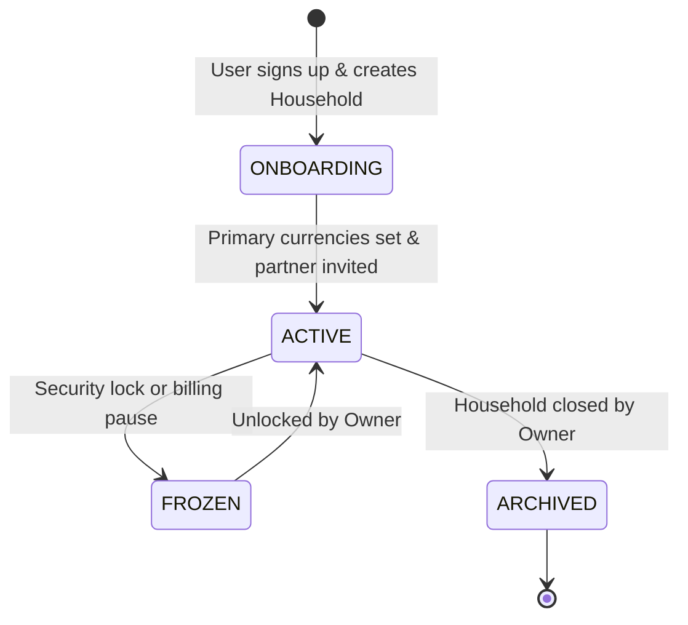
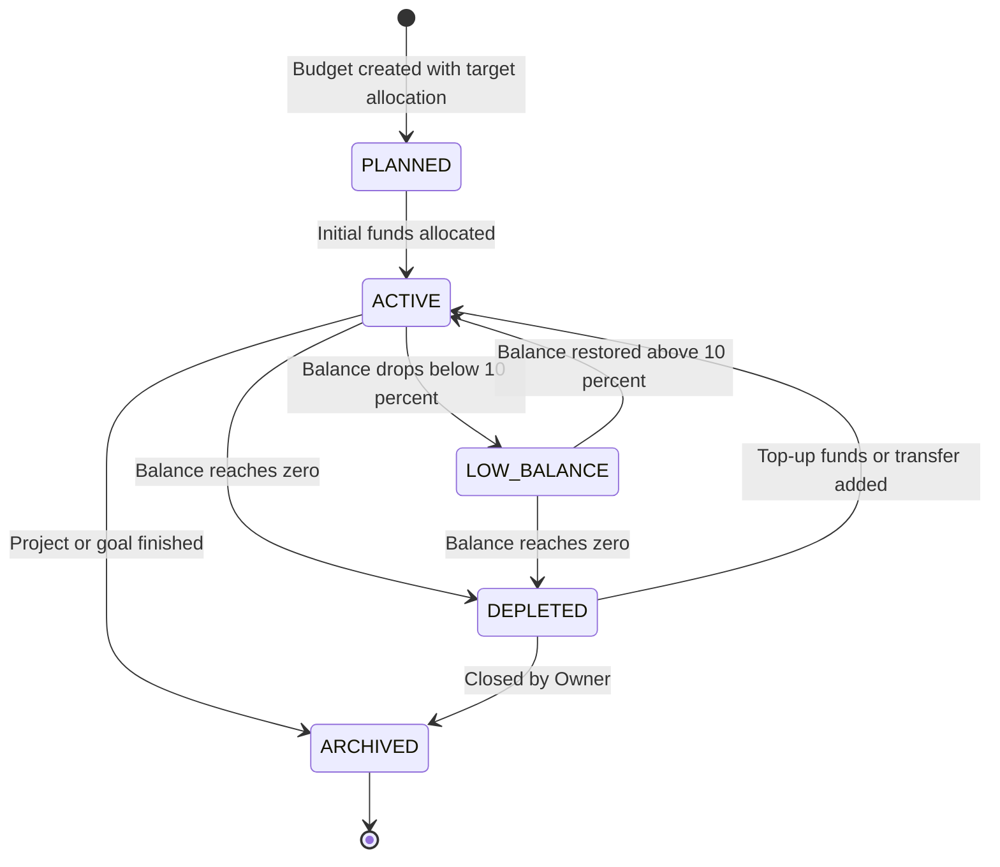
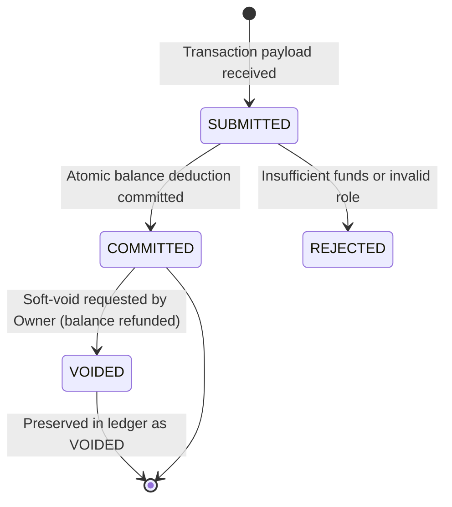
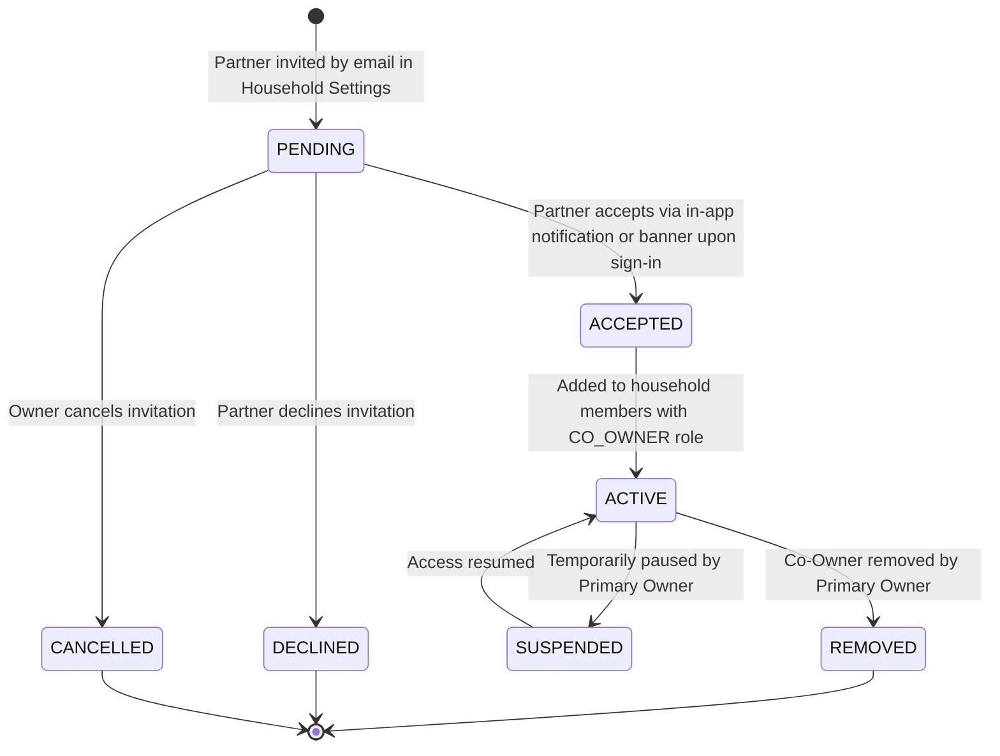
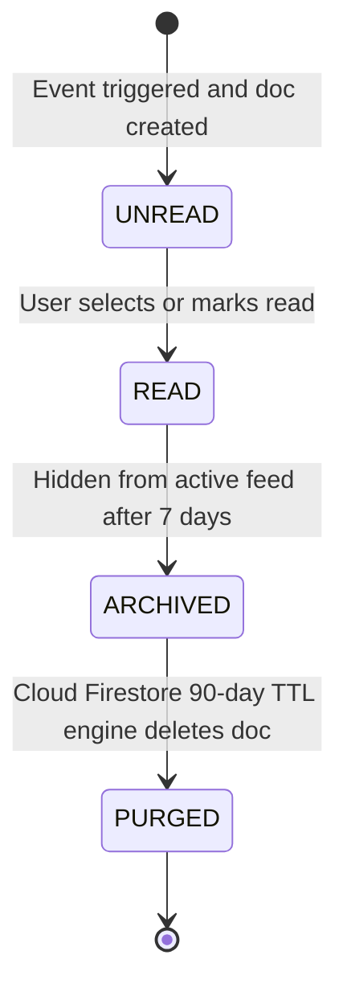
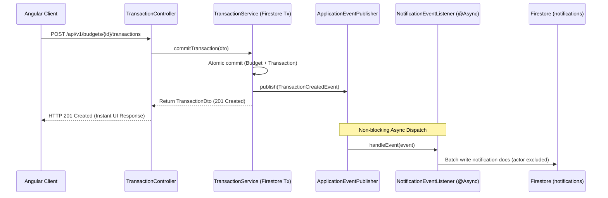

# Design Document: Household Multi-Budget Ledger & In-App Activity Center

## 1. Executive Summary & Problem Context

This design document formalizes the transformation of the Expense Tracker into a **Household-Centric Multi-Budget Ledger & In-App Activity Center**.

### Core Objectives

1. **Household Shared Liquidity:** Provide joint visibility for partners/spouses into consolidated remaining liquidity across all shared budgets with cached snapshots.
2. **Sub-3-Tap Mobile Expense Entry:** Deliver a low-friction entry modal leveraging native mobile numeric keypads and smart defaults.
3. **Budget Lifecycle & Rebalancing:** Support finite budget balances (`PLANNED`, `ACTIVE`, `LOW_BALANCE`, `DEPLETED`, `ARCHIVED`) and 1-step inter-budget fund transfers with manual FX support.
4. **Bounded In-App Activity Center:** Guarantee non-blocking alert delivery decoupled via Spring Application Events and backed by Cloud Firestore 90-day TTL.
5. **Immutable Financial Ledger:** Use integer minor currency units (`cents`), hybrid metadata edits, soft-voiding, and snapshot balances (`balanceAfterCents`) to ensure zero-drift audit trails.

---

## 2. Multi-Tier Entity Lifecycles

### 2.1 Household Lifecycle

A **Household** is the primary multi-tenant container representing a shared financial space (e.g., *"Mendoza Family"*).



### 2.2 Budget Lifecycle

A **Budget** is a dedicated virtual container of capital within the household.



### 2.3 Transaction Lifecycle

Transactions are immutable financial events forming the append-only ledger.



### 2.4 Co-Owner In-App Invitation Lifecycle



> **Design Decision (Zero External Email Dependencies):** Rather than integrating a third-party transactional email provider (such as SendGrid or Resend) and custom security tokens, invitations are managed directly in-app:
>
> 1. The Owner enters the partner's email address (`invitedEmail`).
> 2. When the partner signs in with their Google account via Firebase Authentication, the app queries pending invitations matching their verified email.
> 3. An actionable notification card appears in their In-App Activity & Notification Drawer and Dashboard banner to **Accept** or **Decline**.
> 4. Accepting the invitation atomically updates the household membership. This approach leverages Firebase Auth's verified Google identities with zero infrastructure cost and zero third-party dependencies.

### 2.5 Notification & Alert Lifecycle



---

## 3. Core Architectural Decisions (Red Flag Resolutions)

### 3.1 Ledger Auditing & Mutation Strategy (Hybrid Model)

* **Non-Financial Edits (`PATCH /api/v1/budgets/{budgetId}/transactions/{txId}`):** Changes to `note`, `category`, and `receiptUrl` update the document in place without altering balances.
* **Financial / Amount Corrections (`POST /api/v1/budgets/{budgetId}/transactions/{txId}/void` & Re-issue):**
  * To preserve mathematical ledger integrity, modifying amounts marks the original record as `status = VOIDED`, atomically refunds the amount to `budget.currentBalanceCents`, and appends a new corrected transaction with a fresh snapshot balance (`balanceAfterCents`).

### 3.2 Cross-Currency Transfers with Manual Exchange Rates

* Inter-budget transfers between different currencies are supported via an explicit `exchangeRate: double` parameter.
* **Calculation:** `targetAmountCents = Math.round(sourceAmountCents * exchangeRate)`.
* Both sides of the transfer record the applied `exchangeRate` in their metadata.

### 3.3 Concurrency & Contention Policy

* Uses Google Cloud Firestore's built-in **optimistic locking and automatic exponential retry** mechanism in `Firestore.runTransaction()`.
* Fully supports simultaneous entries for household scale (<10 concurrent users).
* *Technical Debt Note:* Sharded distributed counters are documented for future architecture if transaction frequency ever exceeds 1 write/second per budget.

### 3.4 Data Archival & Soft-Deletion Standard

* **Zero-Transaction Budgets:** Can be hard-deleted.
* **Active Budgets with History:** Set to `status: "ARCHIVED"` (hidden from entry pickers, preserved in reports).
* **Transactions:** Set to `status: "VOIDED"` (amount refunded, retained in ledger for auditability).

### 3.5 Event-Driven Decoupled Notifications (Zero Transaction Contention)

To ensure core monetary transactions remain lightning-fast (<100ms) and never fail due to auxiliary notification fan-out, we decouple notification generation using Spring `ApplicationEventPublisher`:



### 3.6 Pre-Calculated Household Liquidity Snapshot

* The `Household` entity maintains `balancesByCurrency: Map<String, Long>` directly on its document.
* When any budget balance changes inside an atomic transaction, the parent household's currency balance map is updated in the same atomic commit.
* **Benefit:** `GET /api/v1/budgets/summary` reads exactly **1 document** instead of querying all $N$ budgets, reducing Firestore read costs by up to $90\%$.

---

## 4. RBAC Permission Matrix (Co-Ownership Model)

| Action / Privilege | **PRIMARY OWNER (Creator)** | **CO-OWNER (Partner)** |
| :--- | :---: | :---: |
| **View Household Consolidated Liquidity** | ✅ | ✅ |
| **Create / Edit / Archive Budgets** | ✅ | ✅ |
| **Log Expenses & Income Top-Ups** | ✅ | ✅ |
| **Edit Metadata / Void Own Transactions** | ✅ | ✅ |
| **Transfer Funds Between Budgets (with FX)** | ✅ | ✅ |
| **Invite & Manage Household Co-Owners** | ✅ | ✅ |
| **Delete / Close the Entire Household** | ✅ | ❌ |

---

## 5. Visual Wireframes & UI Routing Catalog

### Frontend Navigation Architecture

> [!NOTE]
> The wireframes below are framework-agnostic. In the Angular frontend layer, they are implemented using standard **Angular Material 3** components (`@angular/material`).

| Modality | UI Pattern | Route / Trigger | Angular Material 3 Component | Purpose |
| :--- | :--- | :--- | :--- | :--- |
| **Dedicated Route** | Full Page | `/dashboard` | `DashboardComponent` (`MatCard`, `MatProgressBar`) | Main Household overview & active budgets |
| **Dedicated Route** | Full Page | `/households/new` | `HouseholdCreateComponent` (`MatFormField`, `MatInput`) | Onboarding & initial setup |
| **Dedicated Route** | Full Page | `/settings/household` | `HouseholdSettingsComponent` (`MatList`, `MatButton`) | Co-owner management, currencies & danger zone |
| **Dedicated Route** | Full Page | `/budgets/new` | `BudgetCreateComponent` (`MatSelect`, `MatInput`) | Full budget creation form |
| **Dedicated Route** | Full Page | `/budgets/:id` | `BudgetDetailComponent` (`MatTable`, `MatChips`) | Ledger history & transaction table |
| **Dedicated Route** | Full Page | `/budgets/:id/settings` | `BudgetSettingsComponent` (`MatButton`, `MatDialog`) | Budget target adjustment, status & danger zone |
| **Contextual Overlay** | Slide-Up Sheet | *Triggered via FAB `+`* | `MatBottomSheet` | Fast sub-3-tap mobile expense logging |
| **Contextual Overlay** | Slide-Up Sheet | *Triggered via ledger row* | `MatBottomSheet` | Transaction details, note editing & soft-void |
| **Contextual Overlay** | Modal Dialog | *Triggered via Transfer* | `MatDialog` | Inter-budget fund transfers with live FX |
| **Contextual Overlay** | Side Drawer | *Triggered via Bell Icon* | `MatSidenav` | Bounded activity & notification drawer |

---

### 5.1 Household Creation Flow (`/households/new`)

```text
┌─────────────────────────────────────────────────────────┐
│  [Logo] ExpenseTracker                     [ Step 1/2 ] │
├─────────────────────────────────────────────────────────┤
│  CREATE YOUR HOUSEHOLD                                  │
│  Set up a shared space for joint budgeting and expenses.│
│                                                         │
│  Household Name:                                        │
│  ┌───────────────────────────────────────────────────┐  │
│  │ Mendoza Family                                    │  │
│  └───────────────────────────────────────────────────┘  │
│                                                         │
│  Base Currencies (Select all that apply):               │
│  [ ☑ PEN (Peruvian Sol) ]     [ ☑ USD (US Dollar) ]     │
│  [ ☐ EUR (Euro) ]             [ ☐ COP (Colombian Peso) ]│
│                                                         │
│  Invite Partner as Co-Owner (Optional):                 │
│  ┌───────────────────────────────────────────────────┐  │
│  │ maria@example.com (Partner will see on sign-in)   │  │
│  └───────────────────────────────────────────────────┘  │
│                                                         │
│  [ CANCEL ]                    [ CREATE HOUSEHOLD → ]   │
└─────────────────────────────────────────────────────────┘
```

---

### 5.2 Household Settings & Edit Page (`/settings/household`)

```text
┌─────────────────────────────────────────────────────────┐
│  ← Back to Dashboard             [ Household Settings ] │
├─────────────────────────────────────────────────────────┤
│  EDIT HOUSEHOLD DETAILS                                 │
│                                                         │
│  Household Name:                                        │
│  ┌───────────────────────────────────────────────────┐  │
│  │ Mendoza Family                                    │  │
│  └───────────────────────────────────────────────────┘  │
│                                                         │
│  Base Currencies:                                       │
│  [ ☑ PEN (Peruvian Sol) ]     [ ☑ USD (US Dollar) ]     │
│  [ ☐ EUR (Euro) ]             [ ☐ COP (Colombian Peso) ]│
│                                                         │
│  Household Co-Owners:                                   │
│  ┌───────────────────────────────────────────────────┐  │
│  │ 👤 Carlos (You)                 [ Primary Owner ] │  │
│  │ 👤 Maria (maria@example.com)    [ Pending Invite ]│  │
│  │                                 [ Cancel Invite ] │  │
│  │ [ + Invite Co-Owner by Email ]                    │  │
│  └───────────────────────────────────────────────────┘  │
│                                                         │
│  Danger Zone:                                           │
│  [ Archive Household ]         [ Delete Household ]     │
│                                                         │
│  [ CANCEL ]                    [ SAVE CHANGES ]         │
└─────────────────────────────────────────────────────────┘
```

---

### 5.3 Household Dashboard (`/dashboard`)

```text
┌─────────────────────────────────────────────────────────┐
│  [Logo] ExpenseTracker   [🏡 Mendoza Family ▾] [🔔 (3)]│
├─────────────────────────────────────────────────────────┤
│  HOUSEHOLD CONSOLIDATED LIQUIDITY                       │
│  ┌───────────────────────────────────────────────────┐  │
│  │  S/. 14,200.00 PEN                                │  │
│  │  $ 850.00 USD                                     │  │
│  │  [ 4 Active Budgets ]   [ 1 Low Balance Alert ]   │  │
│  │  Members: You (Owner), Maria (Co-Owner)           │  │
│  └───────────────────────────────────────────────────┘  │
│                                                         │
│  ACTIVE BUDGETS                                         │
│                                                         │
│  ┌───────────────────────────────────────────────────┐  │
│  │ 🍳 Kitchen Renovation               [CO-OWNER][PEN]│  │
│  │ S/. 3,450.00 remaining of S/. 5,000.00            │  │
│  │ [████████████████████░░░░░░░░░░░░] 69% (Healthy)  │  │
│  │ Last: S/. 250.00 (Plumbing) • 2h ago              │  │
│  └───────────────────────────────────────────────────┘  │
│                                                         │
│  ┌───────────────────────────────────────────────────┐  │
│  │ 🛒 Groceries & Market               [CO-OWNER][PEN]│  │
│  │ S/. 180.00 remaining of S/. 2,000.00              │  │
│  │ [██░░░░░░░░░░░░░░░░░░░░░░░░░░░░░░] 9% (⚠️ Low)    │  │
│  │ Last: S/. 85.00 (Supermarket) • Yesterday         │  │
│  └───────────────────────────────────────────────────┘  │
│                                                         │
│  ┌───────────────────────────────────────────────────┐  │
│  │ 🌴 Vacation Trip 2026               [CO-OWNER][USD]│  │
│  │ $ 750.00 remaining of $ 1,000.00                  │  │
│  │ [████████████████████░░░░░░░░░░░░] 75% (Healthy)  │  │
│  │ Last: $ 50.00 (Booking) • 3d ago                  │  │
│  └───────────────────────────────────────────────────┘  │
│                                                         │
│                                       ┌──────────────┐  │
│                                       │   ( + ) FAB  │  │
│                                       └──────────────┘  │
└─────────────────────────────────────────────────────────┘
```

---

### 5.4 Create Budget Page (`/budgets/new`)

```text
┌─────────────────────────────────────────────────────────┐
│  ← Back to Dashboard              [ Create Budget ]     │
├─────────────────────────────────────────────────────────┤
│  CREATE BUDGET                                          │
│  Household: 🏡 Mendoza Family (Shared with Maria)       │
│                                                         │
│  Budget Title:                                          │
│  ┌───────────────────────────────────────────────────┐  │
│  │ Kitchen Renovation                                │  │
│  └───────────────────────────────────────────────────┘  │
│                                                         │
│  Initial Capital Allocation:                            │
│  ┌─────────────────────────────────┬─────────────────┐  │
│  │ 5,000.00                        │ Currency: [PEN▾]│  │
│  └─────────────────────────────────┴─────────────────┘  │
│                                                         │
│  Icon & Classification:                                 │
│  [ 🍳 Home Repair ] [ 🛒 Food ] [ ✈️ Travel ] [ 🚗 Auto ]│
│                                                         │
│  [ CANCEL ]                    [ SAVE BUDGET ]          │
└─────────────────────────────────────────────────────────┘
```

---

### 5.5 Budget Settings & Edit Page (`/budgets/:id/settings`)

```text
┌─────────────────────────────────────────────────────────┐
│  ← Back to Budget Details              [ Edit Budget ]  │
├─────────────────────────────────────────────────────────┤
│  EDIT BUDGET SETTINGS                                   │
│                                                         │
│  Budget Title:                                          │
│  ┌───────────────────────────────────────────────────┐  │
│  │ Kitchen Renovation & Appliances                   │  │
│  └───────────────────────────────────────────────────┘  │
│                                                         │
│  Adjust Total Capital Allocation:                       │
│  ┌─────────────────────────────────┬─────────────────┐  │
│  │ 6,000.00                        │ Currency: [PEN] │  │
│  └─────────────────────────────────┴─────────────────┘  │
│  <small>Current Remaining Balance: S/. 3,450.00</small> │
│                                                         │
│  Icon & Classification:                                 │
│  [ 🍳 Home Repair (Selected) ] [ 🛒 Food ] [ ✈️ Travel ]│
│                                                         │
│  Lifecycle Status:                                      │
│  Status: [ ACTIVE ▾ ] (Options: ACTIVE, ARCHIVED)       │
│                                                         │
│  Danger Zone:                                           │
│  [ 🗑️ Archive Budget & Hide from Active View ]         │
│                                                         │
│  [ CANCEL ]                    [ SAVE CHANGES ]         │
└─────────────────────────────────────────────────────────┘
```

---

### 5.6 Sub-3-Tap Mobile Expense Entry Modal (Bottom Sheet)

```text
┌─────────────────────────────────────────────────────────┐
│                   === Drag Handle ===                   │
│  LOG TRANSACTION                 [ Expense | + Top-up ] │
│                                                         │
│  Budget:                                                │
│  [ Kitchen Renovation (S/. 3,450 remaining)         ▾ ] │
│                                                         │
│  Amount:                                                │
│  ┌───────────────────────────────────────────────────┐  │
│  │   S/. 250.00                                      │  │ (Triggers Native OS Keyboard)
│  └───────────────────────────────────────────────────┘  │
│                                                         │
│  Date:     [ Today, 25 Sep 2026                    📅 ] │
│  Category: [ Plumbing Materials                     ▾ ] │
│  Note:     [ PVC pipes and waterproof sealant         ] │
│                                                         │
│  [  CONFIRM & SAVE TRANSACTION (Tap 3)  ]               │
└─────────────────────────────────────────────────────────┘
```

---

### 5.7 Transaction Edit / Delete Modal (Slide-Up Sheet)

```text
┌─────────────────────────────────────────────────────────┐
│                   === Drag Handle ===                   │
│  EDIT TRANSACTION                                       │
│  Budget: Kitchen Renovation                             │
│                                                         │
│  Amount:                                                │
│  ┌───────────────────────────────────────────────────┐  │
│  │ S/. 250.00                                        │  │ (Directly editable)
│  └───────────────────────────────────────────────────┘  │
│                                                         │
│  Date:     [ 25 Sep 2026                           📅 ] │
│  Category: [ Plumbing Materials                     ▾ ] │
│  Note:     [ PVC pipes and waterproof sealant         ] │
│                                                         │
│  [ 🗑️ Delete Transaction ]                              │
│                                                         │
│  [ CANCEL ]                    [ SAVE CHANGES ]         │
└─────────────────────────────────────────────────────────┘
```

---

### 5.8 Inter-Budget Transfer & Split Modal with FX

```text
┌─────────────────────────────────────────────────────────┐
│  TRANSFER / SPLIT BUDGET FUNDS                          │
├─────────────────────────────────────────────────────────┤
│  Source Budget:                                         │
│  General Savings ($750.00 USD available)                │
│                                                         │
│  Destination Budget:                                    │
│  [ Groceries & Market (PEN)                         ▾ ] │
│                                                         │
│  Transfer Amount:                                       │
│  ┌───────────────────────────────────────────────────┐  │
│  │ $ 100.00 USD                                      │  │
│  └───────────────────────────────────────────────────┘  │
│                                                         │
│  Exchange Rate (USD → PEN):                             │
│  ┌─────────────────────────────────┬─────────────────┐  │
│  │ 1 USD = [ 3.75 ] PEN            │ S/. 375.00 PEN  │  │
│  └─────────────────────────────────┴─────────────────┘  │
│                                                         │
│  Note (Optional):                                       │
│  ┌───────────────────────────────────────────────────┐  │
│  │ Converted USD savings for weekly groceries        │  │
│  └───────────────────────────────────────────────────┘  │
│                                                         │
│  [ CANCEL ]                    [ CONFIRM TRANSFER ]     │
└─────────────────────────────────────────────────────────┘
```

---

### 5.9 In-App Activity & Notification Drawer

```text
┌─────────────────────────────────────────────────────────┐
│  Activity & Notifications              [Mark All Read]  │
├─────────────────────────────────────────────────────────┤
│  📩 PENDING INVITATIONS                                 │
│  ┌───────────────────────────────────────────────────┐  │
│  │ 🏠 Household Invitation             • Just now    │  │
│  │ Carlos invited you to join "Mendoza Family"       │  │
│  │ Role: Co-Owner                                    │  │
│  │                                                   │  │
│  │         [ ✅ Accept ]      [ ❌ Decline ]          │  │
│  └───────────────────────────────────────────────────┘  │
│                                                         │
│  🔴 RECENT ACTIVITY (Last 7 Days)                       │
│  ┌───────────────────────────────────────────────────┐  │
│  │ 💸 Expense Logged                   • 10m ago     │  │
│  │ Maria logged S/. 250.00 on "Kitchen Renovation"   │  │
│  │ Balance: S/. 3,450.00                             │  │
│  │                                                   │  │
│  │ [ ↗ View Budget (/budgets/bdg_123) ]   [ ✓ Read ] │  │
│  └───────────────────────────────────────────────────┘  │
│                                                         │
│  ┌───────────────────────────────────────────────────┐  │
│  │ ⚠️ Low Balance Alert                • 2h ago      │  │
│  │ "Groceries & Market" dropped below 10%            │  │
│  │ Balance: S/. 180.00 (9% remaining)                │  │
│  │                                                   │  │
│  │ [ ↗ View Budget (/budgets/bdg_456) ]   [ ✓ Read ] │  │
│  └───────────────────────────────────────────────────┘  │
│                                                         │
│  [ Load More Earlier Activity (Page 1 of 3) ▾ ]         │
│                                                         │
│  [ Close Activity Drawer ]                              │
└─────────────────────────────────────────────────────────┘
```

---

### 5.10 Budget Details & Immutable Ledger History (`/budgets/:id`)

```text
┌─────────────────────────────────────────────────────────┐
│  ← Back to Budgets                      [⚙️ Settings]   │
├─────────────────────────────────────────────────────────┤
│  Kitchen Renovation                      [Active]       │
│  Household: Mendoza Family • Co-Owner: Maria            │
│                                                         │
│  Remaining Balance: S/. 3,450.00                        │
│  Initial Budget:    S/. 5,000.00                        │
│  Total Spent:       S/. 1,550.00 (31%)                  │
│                                                         │
│  [ + Log Expense ]   [ 💰 + Add Funds ]   [ ⇄ Transfer ]│
│                                                         │
│  IMMUTABLE LEDGER HISTORY                               │
│  ┌────────────┬─────────────────────┬─────────┬──────┐  │
│  │ Date       │ Description         │ Amount  │ Bal. │  │
│  ├────────────┼─────────────────────┼─────────┼──────┤  │
│  │ 25/09 01:15│ PVC Pipes (Carlos)  │ -250.00 │ 3450 │  │
│  │ 24/09 18:30│ Cement Bags (Maria) │ -800.00 │ 3700 │  │
│  │ 23/09 09:00│ Tool Rental (Carlos)│ -500.00 │ 4500 │  │
│  │ 22/09 10:00│ Initial Allocation  │+5000.00 │ 5000 │  │
│  └────────────┴─────────────────────┴─────────┴──────┘  │
└─────────────────────────────────────────────────────────┘
```

---

## 6. Domain Entities & Storage Architecture

```yaml
Household (Collection: households/{householdId}):
  id: string
  name: string
  status: "ONBOARDING" | "ACTIVE" | "FROZEN" | "ARCHIVED"
  baseCurrencies: string[] # ["PEN", "USD"]
  balancesByCurrency: Map<string, long> # Pre-calculated snapshot: { "PEN": 1420000, "USD": 85000 }
  activeBudgetCount: int # Cached active count for 1-document summary read (§3.6)
  ownerId: string # Primary Creator UID
  members:
    "usr_carlos_123": { role: "PRIMARY_OWNER", displayName: "Carlos", email: "carlos@example.com", status: "ACTIVE" }
    "usr_maria_456": { role: "CO_OWNER", displayName: "Maria", email: "maria@example.com", status: "ACTIVE" }
  memberIds: string[]
  createdAt: Instant
  updatedAt: Instant

Budget (Collection: budgets/{budgetId}):
  id: string
  householdId: string # Mandatory link to parent Household
  title: string
  initialAmountCents: long (e.g. 500000 for S/. 5,000.00)
  currentBalanceCents: long (e.g. 345000 for S/. 3,450.00)
  currency: string
  status: "PLANNED" | "ACTIVE" | "LOW_BALANCE" | "DEPLETED" | "ARCHIVED"
  ownerId: string
  createdAt: Instant
  updatedAt: Instant

Transaction (Collection: budgets/{budgetId}/transactions/{txId}):
  id: string
  householdId: string
  budgetId: string
  idempotencyKey: string
  type: "SPENDING" | "INCOME" | "ADJUSTMENT" | "TRANSFER_OUT" | "TRANSFER_IN"
  status: "COMMITTED" | "VOIDED"
  amountCents: long
  balanceAfterCents: long
  category: string
  note: string (nullable)
  linkedBudgetId: string (nullable)
  transferGroupId: string (nullable)
  exchangeRate: double (nullable, e.g. 3.75)
  transactionDate: Instant
  createdBy: string
  createdByName: string
  createdAt: Instant

Notification (Collection: notifications/{notificationId}):
  id: string
  householdId: string
  recipientId: string
  actorId: string
  budgetId: string (nullable)
  budgetTitle: string (nullable)
  invitationId: string (nullable, for HOUSEHOLD_INVITATION type)
  type: "HOUSEHOLD_INVITATION" | "BUDGET_CREATED" | "BUDGET_DEPLETED" | "LOW_BALANCE_WARNING" | "EXPENSE_LOGGED" | "FUNDS_ADDED"
  title: string
  message: string
  isRead: boolean
  expiresAt: Instant (now + 90 days TTL)
  createdAt: Instant

HouseholdInvitation (Collection: householdInvitations/{invitationId}):
  id: string
  householdId: string
  householdName: string
  inviterId: string
  inviterName: string
  invitedEmail: string (case-normalized lowercase)
  role: "CO_OWNER"
  status: "PENDING" | "ACCEPTED" | "DECLINED" | "CANCELLED"
  createdAt: Instant
  updatedAt: Instant
```

---

## 7. REST API Contracts (`/api/v1/...`)

> [!IMPORTANT]
> **API Standards & Security Invariants:**
>
> * **Authentication:** All `/api/v1/*` endpoints require a valid Firebase ID token in `Authorization: Bearer <token>`. The authenticated caller's identity (`uid`, `email`) is extracted securely from the server-side security context; user IDs are never accepted from client-supplied request bodies.
> * **Monetary Units:** All monetary amounts ending in `Cents` are strictly stored and transmitted in integer minor units (`long`). Floating-point `double` or `float` is prohibited for currency values.

| Method | Path | Description | Request Body | Response Body |
| :--- | :--- | :--- | :--- | :--- |
| `POST` | `/api/v1/households` | Create Household | `{ name: string, baseCurrencies: string[], partnerEmail?: string }` | `201 Created` $\to$ `HouseholdDto` |
| `GET` | `/api/v1/households/current` | Get Active Household | *None* | `200 OK` $\to$ `HouseholdDto` |
| `GET` | `/api/v1/households/{id}` | Get Household Details | *None* | `200 OK` $\to$ `HouseholdDto` |
| `PATCH` | `/api/v1/households/{id}` | Update Household Settings | `{ name?: string, baseCurrencies?: string[] }` | `200 OK` $\to$ `HouseholdDto` |
| `POST` | `/api/v1/households/{id}/invitations` | Invite Co-Owner by Email | `{ invitedEmail: string }` | `201 Created` $\to$ `HouseholdInvitationDto` |
| `GET` | `/api/v1/households/{id}/invitations` | List Household Invitations | *None* | `200 OK` $\to$ `HouseholdInvitationDto[]` |
| `GET` | `/api/v1/invitations/pending` | List Pending Invitations for Signed-In User | *None* | `200 OK` $\to$ `HouseholdInvitationDto[]` |
| `POST` | `/api/v1/invitations/{id}/accept` | Accept Household Invitation | *None* | `200 OK` $\to$ `HouseholdDto` |
| `POST` | `/api/v1/invitations/{id}/decline` | Decline Household Invitation | *None* | `200 OK` $\to$ `{ id: string, status: "DECLINED" }` |
| `DELETE` | `/api/v1/households/{id}/invitations/{invitationId}` | Cancel Pending Invitation (Owner only) | *None* | `204 No Content` |
| `POST` | `/api/v1/budgets` | Create Budget | `{ householdId: string, title: string, initialAmountCents: long, currency: string }` | `201 Created` $\to$ `BudgetDto` |
| `GET` | `/api/v1/budgets` | List Budgets | *Query:* `?householdId=...&status=ACTIVE` | `200 OK` $\to$ `{ items: BudgetDto[], nextCursor: string }` |
| `GET` | `/api/v1/budgets/{id}` | Get Budget by ID | *None* | `200 OK` $\to$ `BudgetDto` |
| `PATCH` | `/api/v1/budgets/{id}` | Update Budget Settings | `{ title?: string, initialAmountCents?: long, status?: string }` | `200 OK` $\to$ `BudgetDto` |
| `GET` | `/api/v1/budgets/summary` | Consolidated Liquidity | *Query:* `?householdId=...` | `200 OK` $\to$ `{ balancesByCurrency: { [curr]: long }, activeCount: int }` |
| `POST` | `/api/v1/budgets/{id}/transactions` | Log Expense / Top-Up | `{ type: "SPENDING"\|"INCOME", amountCents: long, category: string, note?: string, transactionDate: string }` | `201 Created` $\to$ `TransactionDto` |
| `GET` | `/api/v1/budgets/{id}/transactions` | List Ledger Transactions | *Query:* `?limit=50` | `200 OK` $\to$ `TransactionDto[]` |
| `PATCH` | `/api/v1/budgets/{id}/transactions/{txId}` | Update Metadata (Note/Category) | `{ category?: string, note?: string }` | `200 OK` $\to$ `TransactionDto` |
| `POST` | `/api/v1/budgets/{id}/transactions/{txId}/void` | Void & Refund Transaction | *None* | `200 OK` $\to$ `TransactionDto` |
| `POST` | `/api/v1/budgets/transfers` | 1-Step Atomic Transfer (with optional FX) | `{ sourceBudgetId: string, targetBudgetId: string, sourceAmountCents: long, exchangeRate?: double, note?: string }` | `200 OK` $\to$ `TransferResultDto` |
| `GET` | `/api/v1/notifications` | Paginated Activity Feed | *Query:* `?limit=20&cursor=...` | `200 OK` $\to$ `{ items: NotificationDto[], nextCursor: string }` |
| `PATCH` | `/api/v1/notifications/{id}/read` | Mark Alert Read | *None* | `200 OK` $\to$ `{ id: string, isRead: true }` |
| `POST` | `/api/v1/notifications/mark-all-read` | Mark All Read | *None* | `200 OK` $\to$ `{ updatedCount: int }` |

---

## 8. Verification Protocol & Backend Test Strategy

### 8.1 Testing Philosophy & Core Invariants

In accordance with [docs/DESIGN_PHILOSOPHY.md](../DESIGN_PHILOSOPHY.md) (*A Philosophy of Software Design* by John Ousterhout) and [backend/AGENTS.md](../../backend/AGENTS.md):

1. **Test Deep Contracts, Not Internal Mechanics:** Verify the public API contracts of deep services and REST controllers rather than internal implementation mechanics. Avoid brittle, repetitive Mockito chains simulating Google Cloud Firestore SDK internals (`collection().document().get()`).
2. **Define Errors Out of Existence:** Test that APIs and domain services handle idempotent operations, boundary edge conditions, and null-like queries gracefully (e.g. repeated soft-void requests, duplicate invitation acceptances, and empty result queries returning safe empty collections).
3. **Guard Critical Financial Invariants:**
   * **Integer Minor Units:** All monetary values (`amountCents`, `balanceAfterCents`, `initialAmountCents`) must be strictly tested as `long` cents. Ensure zero floating-point `double`/`float` leakage in financial calculations.
   * **Identity & Tenant Isolation:** Verify that the actor's identity (`uid`, `email`) is extracted strictly from the authenticated server-side `SecurityContextHolder` (`Principal.getName()`), never from client-supplied request payloads. Verify that cross-household requests are rejected with `403 Forbidden`.
   * **Atomic Concurrency & Rollbacks:** Ensure inter-budget transfers and soft-void operations execute atomically inside Firestore transaction batches, guaranteeing zero ledger balance drift if any single step fails.

---

### 8.2 Backend Multi-Layer Test Pyramid

```
                ┌──────────────────────────────────┐
                │   Layer 4: Firestore Emulator    │  <-- Multi-doc transactions, compound
                │       Integration Tests          │      queries & atomic rollbacks
                ├──────────────────────────────────┤
                │   Layer 3: Security & Filters    │  <-- FirebaseTokenFilter, 401/403,
                │         Web Security             │      CORS preflight, Principal populating
                ├──────────────────────────────────┤
                │   Layer 2: Controller Slices     │  <-- @WebMvcTest, Bean Validation (@Valid),
                │       (@WebMvcTest + MockMvc)    │      HTTP 200/201/400, DTO serialization
                ├──────────────────────────────────┤
                │   Layer 1: Pure Domain & Unit    │  <-- Cents math, FX rates, state machine
                │       (JUnit 5 + AssertJ)        │      transitions (ACTIVE -> LOW_BALANCE)
                └──────────────────────────────────┘
```

#### Layer 1: Pure Domain & Calculation Unit Tests (JUnit 5 + AssertJ)

* **Scope:** Zero Spring context; fast, sub-second execution.

* **Coverage:**
  * Integer cents arithmetic and FX conversion rounding (`Math.round(sourceCents * exchangeRate)`).
  * Budget lifecycle state machine derivation:
    * Balance drops below 10% $\to$ `LOW_BALANCE`.
    * Balance drops to 0 $\to$ `DEPLETED`.
    * Balance replenished $\to$ `ACTIVE`.
  * Transaction soft-void reversal calculations:
    * Voided transaction produces offsetting ledger entries or balance restorations with `isVoided = true`.

#### Layer 2: REST Controller Slice Tests (`@WebMvcTest`)

* **Scope:** Spring MVC test slice with mocked service dependencies (`@MockBean`).

* **Coverage:**
  * Verification of `/api/v1/...` REST routing.
  * Jakarta Bean Validation (`@NotNull`, `@Min(1)`, `@Size`, `@Email`): ensure malformed requests fail immediately with `400 Bad Request`.
  * JSON serialization/deserialization: camelCase keys, ISO-8601 timestamps, integer cents.
  * HTTP status codes: `201 Created` with `Location` header or created DTO, `200 OK`, `204 No Content`.
  * Identity verification: Ensuring controller delegates to services using the authenticated `Principal.getName()`.

#### Layer 3: Security Filter & Context Tests

* **Scope:** Verification of [FirebaseTokenFilter](../../backend/src/main/java/com/house/expensetracker/security/FirebaseTokenFilter.java) and [SecurityConfig](../../backend/src/main/java/com/house/expensetracker/config/SecurityConfig.java).

* **Coverage:**
  * Requests missing `Authorization: Bearer <token>` fail with `401 Unauthorized`.
  * Requests with invalid or expired Firebase tokens fail with `401 Unauthorized`.
  * Valid tokens populate `SecurityContextHolder` with authenticated `uid` details.
  * CORS preflight `OPTIONS` requests succeed for configured web origins.

#### Layer 4: Deep Service & Firestore Concurrency Integration Tests

* **Scope:** Deep domain services (`HouseholdService`, `BudgetService`, `TransactionService`) tested against the **Firebase Local Emulator Suite** (or Testcontainers) on `localhost:8085`.

* **Coverage:**
  * Atomic transfers between budgets: Verify that when transferring funds from Budget A to Budget B, both documents and the transfer ledger record update together inside a single atomic Firestore transaction.
  * Concurrency & contention: Verify behavior under simultaneous balance mutations.
  * Soft-void idempotency: Calling void twice on the same transaction does not duplicate the balance refund.
  * Event dispatch: Verify Spring Application Events (`TransactionCreatedEvent`, `BudgetLowBalanceEvent`) are emitted without blocking the primary ledger transaction.

---

### 8.3 Deterministic Verification Commands

#### Backend Verification (`/backend`)

```bash
# Run all unit and slice tests
cd backend && ./gradlew test

# Run a specific test suite or class
cd backend && ./gradlew test --tests "*ControllerTest*"
cd backend && ./gradlew test --tests "*ServiceTest*"

# Check compilation and static build without running tests
cd backend && ./gradlew build -x test
```

#### Frontend Headless Verification (`/frontend`)

```bash
# Run Angular unit tests headlessly
cd frontend && npm test -- --watch=false --browsers=ChromeHeadless

# Full frontend production build check
cd frontend && npm run build
```

#### Full Monorepo Build Check

```bash
cd backend && ./gradlew build -x test && cd ../frontend && npm run build
```

---

## 9. Phased Implementation & Token Safety Protocol

> [!IMPORTANT]
> **Token Exhaustion & Mid-Task Stall Prevention:**
> To prevent truncated code generation, lost session state, or uncompilable intermediate builds, implementation must strictly adhere to the following execution invariants:
>
> 1. **One Deep Module Per Turn:** Never attempt to generate multiple services or whole subsystems in a single prompt or turn. Each turn is restricted to at most one module boundary (DTOs + Service/Controller + Tests).
> 2. **Clean Build Checkpoint Invariant:** Every phase and sub-task must conclude with a passing build check (`./gradlew test` or `./gradlew build -x test`). Never proceed to the next task if the current code fails compilation.
> 3. **Persistent Resumability:** The progress checklist below serves as the single source of truth for execution state. If a session runs out of tokens, a new session can read this matrix and resume the exact unfinished task without re-analyzing past conversational history.

### 9.1 Phased Execution Roadmap

```
  Phase 1: Household Core & Security Context
      │
      ▼
  Phase 2: Budget Domain, State Machine & Liquidity
      │
      ▼
  Phase 3: Transactions, Atomic Ledger & Voiding
      │
      ▼
  Phase 4: In-App Household Invitations & Onboarding
      │
      ▼
  Phase 5: Decoupled Alerts & Activity Feed (Events + TTL)
      │
      ▼
  Phase 6: Frontend Angular UI Integration (Routing & Sheets)
      │
      ▼
  Phase 7: End-to-End Verification & Design Doc Archival
```

---

### 9.2 Progress & Checkpoint Matrix

#### Phase 1: Household Core & Security Context

* [x] **1.1 Household DTOs & Validation:** Define `CreateHouseholdRequest`, `UpdateHouseholdRequest`, and `HouseholdDto` with Jakarta Bean Validation.
* [x] **1.2 Household Service & Storage:** Implement `HouseholdService` with Firestore collection `households`, enforcing single active household lookup and multi-currency arrays.
* [x] **1.3 Household Controller, CORS & Security Context:** Implement `/api/v1/households` endpoints. Enrich `FirebaseTokenFilter` to populate authenticated `uid`, `email`, and `displayName` from the verified token, and enable `PATCH` in CORS configuration (`SecurityConfig` / `WebConfig`). Add `@WebMvcTest` and filter tests.
* [x] **1.4 Phase 1 Checkpoint:** Run `cd backend && ./gradlew test` (Ensure green build).

#### Phase 2: Budget Domain, State Machine & Liquidity

* [x] **2.1 Budget DTOs & Lifecycle Domain Logic:** Implement `BudgetDto`, `CreateBudgetRequest`, integer cents math, and unit tests for status derivation (`ACTIVE` $\to$ `LOW_BALANCE` < 10% $\to$ `DEPLETED` == 0).
* [x] **2.2 Budget Service & Atomic Firestore Integration:** Implement `BudgetService` managing `budgets/{budgetId}` with atomic updates to parent `Household.balancesByCurrency` and `activeBudgetCount` on creation, target allocation adjustment, and archival. Add `BudgetServiceTest`.
* [x] **2.3 Budget Controller & Single-Document Liquidity Summary:** Implement `/api/v1/budgets` and `/api/v1/budgets/summary` (reading strictly 1 cached `Household` document per §3.6) with `@WebMvcTest` slices.
* [x] **2.4 Phase 2 Checkpoint:** Run `cd backend && ./gradlew test` (Ensure green build).

#### Phase 3: Transactions, Atomic Ledger & Transfers

* [x] **3.1 Transaction DTOs & Invariants:** Define `LogTransactionRequest`, `TransactionDto`, `TransferRequest`, and `TransferResultDto` strictly using `long amountCents`.
* [x] **3.2 Transaction Service & Atomic Multi-Document Mutations:** Refactor `TransactionService` (removing duplicate `LedgerService`) so `commitTransaction`, `voidTransaction` (idempotent soft-void with refund), and `transferFunds` (inter-budget with FX `Math.round`) execute atomically via `Firestore.runTransaction(...)` / `WriteBatch` and record authenticated `createdByName`. Populate `TransactionServiceTest`.
* [x] **3.3 Transaction Controller & Slice Tests:** Move `/api/v1/budgets/{id}/transactions`, `/api/v1/budgets/{id}/transactions/{txId}`, `/api/v1/budgets/{id}/transactions/{txId}/void`, and `/api/v1/budgets/transfers` into `TransactionController` (keeping `BudgetController` focused strictly on `/api/v1/budgets`). Verify with `TransactionControllerTest`.
* [x] **3.4 Phase 3 Checkpoint:** Run `cd backend && ./gradlew test` (Ensure green build).

#### Phase 4: In-App Household Invitations

* [x] **4.1 Invitation DTOs & State Machine:** Define `InviteCoOwnerRequest`, `HouseholdInvitationDto`, and normalize emails to lowercase.
* [x] **4.2 Invitation Service & Atomic Member Mutation:** Implement invite creation, pending lookup strictly by server-side authenticated email, atomic accept (updating invitation + household `members`/`memberIds` inside a transaction), decline, and Owner-only cancel. Add `HouseholdInvitationServiceTest`.
* [x] **4.3 Invitation Controller Endpoints:** Implement `/api/v1/households/{id}/invitations` and `/api/v1/invitations/...` extracting caller identity (`uid`, `email`, `displayName`) from the security context. Update slice tests.
* [x] **4.4 Phase 4 Checkpoint:** Run `cd backend && ./gradlew test` (Ensure green build).

#### Phase 5: Decoupled Activity Alerts & TTL

* [x] **5.1 Domain Events & Async Publisher:** Enable `@EnableAsync`, define `TransactionCreatedEvent`, `BudgetLowBalanceEvent`, and `BUDGET_DEPLETED` handling in `NotificationEventListener`.
* [x] **5.2 Notification Service & Cursor Pagination:** Implement async notification write to `notifications/{id}` with 90-day TTL `expiresAt` field and cursor-based pagination in `getNotificationFeed`. Add `NotificationServiceTest`.
* [x] **5.3 Notification Controller Endpoints:** Implement `/api/v1/notifications` (paginated feed, mark read, mark all read).
* [x] **5.4 Phase 5 Checkpoint:** Run `cd backend && ./gradlew test` (Ensure green build).

#### Phase 6: Frontend Angular UI Integration (`frontend/AGENTS.md` Compliant)

* [ ] **6.1 Angular Services & Models:** Enforce `readonly` DI, `import type`, strict server-side identity calls on `HouseholdService`, `BudgetService`, and `NotificationService`, and add colocated `.spec.ts` unit tests.
* [ ] **6.2 Household Routes (`/households/new` & `/settings/household`):** Implement `HouseholdCreateComponent` (§5.1) and `HouseholdSettingsComponent` (§5.2: edit name/currencies, invite co-owner, view/cancel pending invites, archive/delete household) using Reactive Forms, Signals, and colocated `.spec.ts` tests.
* [ ] **6.3 Budget Creation & Settings Routes (`/budgets/new` & `/budgets/:id/settings`):** Implement `BudgetCreateComponent` (§5.4) and `BudgetSettingsComponent` (§5.5: rename, adjust total capital allocation, archive budget) with Reactive Forms, Signals, and colocated `.spec.ts` tests.
* [ ] **6.4 Budget Details Route (`/budgets/:id`) & Transaction Edit Sheet (§5.7 & §5.10):** Implement `BudgetDetailComponent` (`MatTable`, `MatChips`, action bar) and `TransactionEditSheetComponent` (`MatBottomSheet` for category/note edits and soft-void) with colocated `.spec.ts` tests.
* [ ] **6.5 Sub-3-Tap Mobile Expense Entry & Inter-Budget Transfer Overlays (§5.6 & §5.8):** Refactor `ExpenseEntrySheetComponent` and `TransferModalComponent` to strict Angular 20+ standards (no `standalone: true`, no `CommonModule`, Reactive Forms, `inject(MAT_...)`) with colocated `.spec.ts` tests.
* [ ] **6.6 Dashboard (`/dashboard`) & In-App Activity Drawer (§5.3 & §5.9):** Refactor `DashboardComponent` and `ActivityDrawerComponent` (`input()`/`output()` signals, pending invitations accept/decline in drawer, `[ ↗ View Budget ]` deep-links, pagination, zero `any`, `??` over `||`, Google style terminology) and register all §5 routes in `app.routes.ts`.
* [ ] **6.7 Phase 6 Checkpoint:** Run `cd frontend && npm test -- --watch=false --browsers=ChromeHeadless` and `npm run build`.

#### Phase 7: Full Monorepo Verification & Lifecycle Archival

* [ ] **7.1 Full Monorepo Build Check:** Execute `cd backend && ./gradlew build -x test && cd ../frontend && npm run build`.
* [ ] **7.2 Full Test Suite:** Execute all backend and frontend unit/integration test suites.
* [ ] **7.3 Lifecycle Archival:** Move `household_multi_budget_ledger.md` to `docs/archive/` and update `README.md`.
